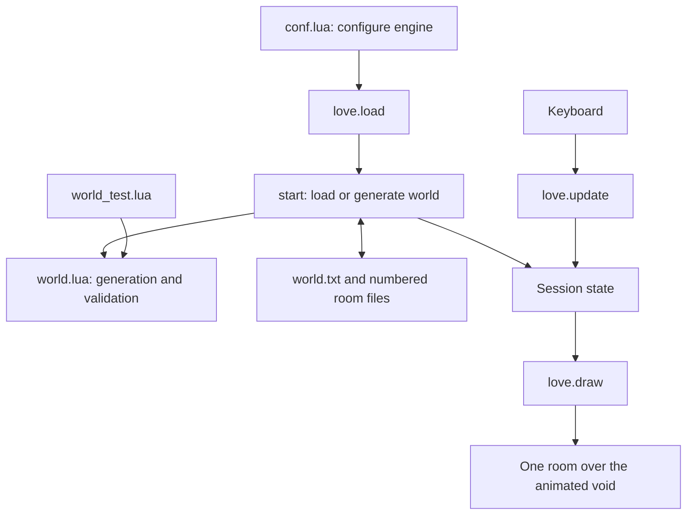

# ISOMET — The Quiet Between

## Prototype design and source guide

This document describes the implemented first version: a Lua game running in LÖVE 11.5. It explains the responsibilities of every source function, the data that flows between them, the algorithms behind exploration and rendering, and the tradeoffs made to keep the prototype small.

The game is an exploration maze in a dimensional void. The player visits one floating room at a time, passes through luminous arches, and searches for a violet escape portal. The design establishes movement, atmosphere, procedural layout, and editable persistence as a foundation for later RPG mechanics. Combat, inventory, statistics, dialogue, and quests are not implemented.

## 1. Player experience

A new world contains twelve rectangular rooms, each seven to ten tiles wide and high. Rooms have one to four connected sides. Each connected side has one centered arch. Sparse pillars decorate the floor without obstructing the central crossing paths in generated rooms.

The player starts at the center of room 1. Arrows or WASD move along the room's isometric axes; Shift increases speed. Walking into an exit transfers the player to the opposite edge of its connected room. A discovery counter tracks unique rooms visited during the current attempt. Walking into the escape portal ends the attempt and displays the discovery count and number of room transitions.

| Input | Action |
| --- | --- |
| Up / W | Northeast |
| Right / D | Southeast |
| Down / S | Southwest |
| Left / A | Northwest |
| Shift | Run |
| F5 | Reload saved rooms and restart in room 1 |
| Ctrl+N | Generate and save a replacement maze immediately |
| O | Open the save directory |
| Escape | Quit |

The world layout persists across launches. Position, discoveries, transition count, and victory do not persist. A new launch begins another attempt in the same maze.

## 2. Source organization

| File | Responsibility |
| --- | --- |
| `conf.lua` | Configure LÖVE before the game starts |
| `world.lua` | Generate, serialize, parse, and validate room data |
| `main.lua` | Manage the session, files, input, movement, rendering, and victory |
| `characters.lua` | Build eight character sprites, present selection, and manage name input |
| `tests/world_test.lua` | Exercise world generation and text serialization without launching LÖVE |
| `README.md` | Explain launch instructions, controls, and room editing |
| `DESIGN.md` | Explain the implementation and its design principles |

`world.lua` has no dependency on LÖVE. It returns a module table, imported in `main.lua` with `require('world')`. The main program adapts that module to LÖVE's filesystem, random number generator, and graphics APIs.



## 3. Engine configuration: `conf.lua`

LÖVE calls `love.conf(t)` before loading the main program.

- `t.identity = 'isomet-void'` selects the game's save directory identity.
- `t.version = '11.5'` declares the target LÖVE version.
- The initial window is 1200 × 800, resizable, with an 800 × 600 minimum.
- The title identifies the game.
- The audio module is disabled because the prototype has no sound.
- `t.console = false` disables the separate console window on platforms where that option applies.

No assets or third-party Lua libraries need to be installed. Fonts use LÖVE's default font; the character and scenery are constructed in code.

## 4. Data model

### Room tables

Rooms live in a consecutive Lua array: `rooms[1]`, `rooms[2]`, and so on. IDs are one-based. A room has this conceptual structure:

```lua
{
    id = 1,
    name = 'The First Silence',
    width = 8,
    height = 9,
    exits = { NE = 2, SE = 3 },
    pillars = { { x = 2.5, y = 2.5 } },
    portal = false,
    gx = 0,
    gy = 0
}
```

`exits` maps a side to another room's ID. Absent entries mean that side has no exit. `pillars` contains floor positions. `portal` marks the room containing the escape; absent or false both mean no portal.

`gx` and `gy` are temporary coordinates used to construct the world graph. They are not saved, and loaded rooms do not need them. Gameplay follows exit links rather than looking up neighboring grid coordinates.

### Session state in `main.lua`

| Variable | Meaning |
| --- | --- |
| `rooms` | The current world's room array |
| `roomId` | ID of the single active room |
| `player` | Continuous floor coordinates `x`, `y` |
| `visited` | Set represented by room IDs mapped to `true` |
| `stars` | 180 generated background particle descriptions |
| `time` | Accumulated, clamped update time used for animation |
| `fade` | Transition overlay strength, initially 1 after starting or changing rooms |
| `steps` | Number of room transitions, not walking steps |
| `won` | Whether the escape has been reached |
| `fonts` | Three font sizes for the interface |
| `character` | Generated character image |
| `errorText` | Load/save/validation error shown instead of gameplay |
| `ox`, `oy`, `scale` | Current rendering origin and room scale |

Most state is local to the Lua module. LÖVE callbacks share it through Lua's lexical scope rather than placing it in globals.

## 5. World generation: `world.lua`

### `W.opposite`

The module exposes the direction lookup used by both generation and room transitions:

```text
NE ↔ SW
NW ↔ SE
```

This is the common definition of how an exit relates to the destination entrance.

### `W.generate(random)`

The generator accepts a random-number function with the signature `random(min, max)`. Gameplay supplies `love.math.random`; tests supply `math.random`.

1. Create room 1 at world-grid coordinate `(0, 0)`.
2. Repeatedly choose an existing room and one of its four neighboring grid positions.
3. If that position is unoccupied, create a room there and connect it in both directions.
4. Continue until there are twelve rooms.
5. Consider extra links between adjacent existing rooms, creating occasional loops.
6. Scatter pillars while preserving the central crossing paths.
7. Find a room at maximum shortest-path distance from room 1 and put the portal there.

The nested `add(x, y)` function assigns the next ID, chooses dimensions from 7–10, assigns a name from a fixed list, initializes the room's tables, and records occupancy in `cells` using a string key such as `'0,-1'`.

Each newly created room is attached to an existing room, so the initial graph is connected by construction. Before extra links, it is a tree: there is one route between any two rooms. Additional links can create alternative exploration routes. Each directed consideration of an absent neighboring link has a one-in-three chance of adding it; because a still-absent pair can be considered from both ends, this is not a one-in-three probability per undirected pair.

Room names depend on creation order. Dimensions, topology, and pillars vary. Generation is seeded from the current time in `love.load`; the seed itself is not saved. Saving the resulting room data is what makes the layout persistent.

### Pillar placement

Candidate tile indices range from 2 through `width - 3` and from 2 through `height - 3`. Pillars are placed at tile centers by adding `0.5` to each index.

A candidate has a one-in-thirteen placement chance and is rejected if either coordinate is within 1.6 tiles of the room's center axis:

```lua
math.abs(x + .5 - room.width / 2) < 1.6
    or math.abs(y + .5 - room.height / 2) < 1.6
```

The rejected area forms a clear cross through the room. Centered entrances and the centered portal connect through this cross. Pillars remain in the off-center regions, well inside the edges. The result is sparse decoration rather than an internal labyrinth; the maze is primarily the graph of rooms.

### Escape placement with breadth-first search

The generator starts a queue at room 1 and records its distance as zero. Visiting an unvisited neighbor assigns `distance[current] + 1` and appends that neighbor to the queue. This is breadth-first search (BFS).

In a graph where each exit costs one transition, BFS computes the shortest number of transitions from the start. The generator tracks a room with the greatest distance and sets its `portal` field to true. The portal is therefore placed far away in graph distance, not necessarily screen-space distance or walking distance. Equal-distance ties depend on traversal order.

The generation BFS loop is explicitly bounded to twelve entries, matching this prototype's fixed generated world size. Expanding the generator should change that bound along with the room target and name list.

## 6. Persistence and editable room files

### Disk layout

LÖVE writes to its identity-based save directory, not the source project folder:

```text
isomet-void/
    world.txt
    rooms/
        1.room
        2.room
        ...
        12.room
```

`world.txt` contains the room count. Room files use consecutive IDs from 1 through that count. Pressing O opens the save directory. See the README for platform-specific default locations.

A representative room file is:

```text
# ISOMET room v1 — coordinates are floor tiles
name = A Quiet Observatory
size = 8 9
portal = false
exit = NE 2
exit = SE 3
pillar = 2.5 2.5
pillar = 5.5 6.5
```

This example describes one room, not a complete valid world. Its destinations must exist and link back, and one room in the complete world must contain a portal.

### `W.encode(r)`

The encoder builds a list of lines and joins them with newline characters. It writes the name, dimensions, explicit portal boolean, exits in NE/SE/SW/NW order, and pillars in their array order. It appends a final newline.

Stable exit ordering makes generated files easy to inspect and supports exact encode/decode round-trip tests. IDs come from filenames, so the room's own ID is not stored inside its text. Temporary world-grid coordinates are omitted.

### `W.decode(text, id)`

The parser starts with an empty room and a default name. It scans nonempty lines using Lua patterns, recognizes `key = value`, and fills the corresponding fields.

| Field | Parsing and behavior |
| --- | --- |
| `name` | Remaining text becomes the display name |
| `size` | Two nonnegative integer strings become width and height |
| `portal` | Only the exact value `true` enables the portal |
| `exit` | Direction and positive-format integer destination; rejects unknown sides and duplicate sides |
| `pillar` | Two decimal-format coordinate strings converted to numbers |

After parsing, dimensions must be between 5 and 16 inclusive. Pillars must satisfy `1 <= x < width - 1` and `1 <= y < height - 1`.

Full-line comments and unrecognized lines are ignored. Inline comments are not generally supported. Duplicate scalar fields overwrite earlier values; duplicate exits are rejected. Unknown fields are ignored, and misspelled boolean values become false. This is a deliberately small parser, not a strict general configuration language.

The loader treats room files as data. It never executes their contents with `load`, `loadstring`, or `dofile`.

### `W.validate(rooms)`

Validation checks the complete graph after parsing or generation:

- Every exit destination exists.
- Every exit is reciprocated on the opposite side.
- Exactly one room contains an escape portal.
- BFS from room 1 reaches every room.

This validates graph connectivity. It does not pathfind around manually placed pillars. A custom room can pass validation while blocking an entrance, spawn point, or portal; its author must preserve walkable routes.

### `saveWorld(world)` in `main.lua`

This helper creates `rooms/`, writes each encoded room, and writes the room count to `world.txt`. Filesystem results are asserted so failures propagate into the surrounding startup error handler.

The manifest is written last, but this is not a transactional save system. An interrupted overwrite can leave a mixture of files. Generating a new world overwrites matching numbered files and does not remove unused higher-numbered files from a previous custom world. Those extra files are ignored if they are outside the manifest count.

### `start(fresh)` in `main.lua`

Startup and restart share one function:

```text
fresh requested OR manifest missing
    → generate → validate → save
otherwise
    → read manifest → decode numbered files → validate
success
    → reset session in room 1
failure
    → set errorText and show recovery instructions
```

`pcall` catches generation, parsing, validation, and filesystem errors. Existing malformed data is not silently regenerated. After success, the player is centered, only room 1 is marked visited, the transition count is zero, victory is cleared, and the fade is reset. Animation time and the star field are not reset by F5.

The expression `tonumber((love.filesystem.read('world.txt')))` has an intentional extra pair of parentheses. LÖVE's read function can return both contents and byte count. Parentheses force a single return value so `tonumber` does not interpret the byte count as its optional numeric base argument.

The manifest checks a numeric range of 1–100; it does not explicitly reject fractional counts. Hand-authored manifests should always contain a whole number.

## 7. LÖVE's lifecycle and frame loop

### `love.load()`

The load callback runs once:

1. Select nearest-neighbor image filtering.
2. Create fonts at sizes 26, 14, and 12.
3. Seed LÖVE's random generator from `os.time()`.
4. Generate eight character images and enable the selection screen with `Characters.load()`.
5. Generate 180 star descriptions.
6. Call `start(false)` to load or create the world.
7. If smoke-test mode is active and startup failed, report the error and request exit status 1.

### `love.update(dt)`

The update callback advances the simulation. Its order matters:

1. Limit `dt` to 0.05 seconds, advance time, and decay the fade.
2. Handle smoke-test timing when enabled.
3. Stop gameplay updates if loading failed, character selection is active, or the player already won.
4. Read movement input and normalize two-axis movement.
5. Choose walking or running speed.
6. Attempt movement with pillar collision checks.
7. Detect an exit or constrain the player to the floor.
8. Refresh the room reference after a possible transition.
9. Check whether the player has entered the escape portal.

Refreshing the room reference in step 8 ensures the portal test uses the destination room after a transition.

### `love.keypressed(key)`

This handles one-time actions rather than continuous motion. Escape quits; F5 reloads; Ctrl+N requests fresh generation; O opens the save directory through a `file://` URL. Continuous movement uses `isDown` in the update callback so holding a key moves every frame.

### `love.draw()`

Drawing reads current state, computes the room's screen placement, and renders the scene. It does not move the player or change room connections. The projection origin and scale are updated here because they depend on current window dimensions.

## 8. Movement and collision

### Floor coordinates and input

Gameplay uses continuous `(x, y)` coordinates on a flat rectangular floor, independent of display pixels.

| Direction | Floor-coordinate change | Projected direction |
| --- | --- | --- |
| NE | Decrease `y` | Up and right |
| SE | Increase `x` | Down and right |
| SW | Increase `y` | Down and left |
| NW | Decrease `x` | Up and left |

Opposite keys cancel. If both axes are nonzero, each component is multiplied by approximately `1 / sqrt(2)`, or `0.7071`. This keeps two-axis movement at the same speed in floor coordinates. Because the isometric projection compresses the screen's vertical axis, equal floor speeds do not produce equal pixel speeds in every screen direction.

Walking speed is 2.9 tiles per second; running speed is 4.6. Displacement is `direction * speed * dt`. Clamping `dt` limits unusually large jumps after stalls. It is a variable-timestep update with a cap, not a fixed-timestep physics simulation: the game advances less than real elapsed time during long frames.

### Nested `clear(x, y)` helper

The collision helper returns false if a proposed player position is within 0.48 tiles of a pillar on both axes:

```lua
math.abs(x - pillar.x) < .48
    and math.abs(y - pillar.y) < .48
```

This represents a point player against a square exclusion region centered on each pillar. It is a simple axis-aligned collision test in floor space; visible pillar height does not affect collision.

The update tries X movement first, then Y movement using the accepted X position. Rejecting only the blocked axis lets the player slide along pillars. This discrete approach is sufficient for the current speeds and timestep cap; it is not continuous collision detection.

### Exit detection

A doorway trigger requires the player to be within 0.65 tiles of the appropriate edge's midpoint and closer than 0.32 tiles to that edge. Without a valid exit trigger, coordinates are clamped to a 0.35-tile margin inside the room.

Arches are visual objects. Their posts do not have separate collision shapes. Room-boundary constraints and doorway triggers control passage.

### `gatePosition(r, side)` and `changeRoom(side)`

`gatePosition` returns the shared visual location for an arch: the center of its edge, inset by 0.15 tiles. Using one helper keeps rendering and destination placement consistent.

`changeRoom` follows the current room's exit, looks up the opposite side, and places the player one tile inside that destination edge. The inward offset prevents immediate bouncing back through the entrance. The function then marks the room visited, increments `steps`, and resets the fade.

Only the active room changes. Other room tables remain in memory, and no new generation occurs during a transition.

### Victory

In a portal room, the squared distance from the player to the room center is compared with `0.55^2`. Avoiding a square root is sufficient because only a distance comparison is needed. Entering that radius sets `won = true`; subsequent gameplay updates stop while background animation continues.

## 9. Isometric rendering

### `project(x, y, z)`

The projection converts floor coordinates into screen coordinates:

```text
screenX = ox + (x - y) × 30 × scale
screenY = oy + (x + y) × 15 × scale - z × scale
```

At scale 1, a floor tile is 60 pixels wide and 30 pixels high. This familiar 2:1 diamond projection creates the isometric appearance. `z` is an optional visual elevation in unscaled pixels, not a third gameplay coordinate. The game does not use a 3D camera or 3D physics.

For a tile at `(x, y)`, `diamond` projects its four corners: `(x,y)`, `(x+1,y)`, `(x+1,y+1)`, and `(x,y+1)`. It fills the resulting polygon and outlines it faintly.

### Fitting and centering the room

The projected floor width is `(width + height) * 30`, and its height is `(width + height) * 15`, before scaling. `love.draw` chooses the minimum of the available horizontal fit, available vertical fit with space for tall objects, and a maximum scale of 1.5.

The origin accounts for rectangular rooms: `(width - height)` shifts the projection's center horizontally, while `(width + height)` sets its vertical center. The viewport reserves room for the interface. Resizing the window recomputes the fit; there is no scrolling camera.

### Scene drawing order

1. Dark background clear.
2. Seven broad, translucent moving ellipses suggesting distant void clouds.
3. Drifting and twinkling stars.
4. Floating platform side faces.
5. Floor tiles with faint seams and deterministic color variation.
6. Small luminous markers at exits.
7. Depth-sorted pillars, arches, portal, and player.
8. Room title, discovery counter, objective, and controls.
9. Transition fade.
10. Victory overlay when appropriate.

If `errorText` exists, drawing stops after the background and an error message with recovery controls.

### `color(r, g, b, a)`

This small wrapper calls `love.graphics.setColor` and defaults alpha to 1. Colors use LÖVE's normalized 0–1 channels.

### Floor and platform

Two shaded side polygons make the diamond floor look like a floating slab, with a visual thickness of `20 * scale` pixels. The floor palette cycles through four muted color groups based on room ID. A formula based on tile coordinates and room ID introduces small brightness differences. These variations are deterministic and do not consume random values during drawing.

### Depth sorting: the painter's algorithm

Each freestanding object contributes a table with a `depth` and a drawing closure. Depth is its floor position's `x + y`. Objects are sorted ascending, so objects farther down the projected floor are drawn later and can cover objects behind them.

Closures preserve the pillar, side, room, or player information needed when drawing is deferred until after sorting. The exit loop uses a local copy of its side for its closure.

This is a lightweight painter's algorithm. There is no depth buffer. Each whole arch is sorted as a single object at its center, which can produce imperfect overlaps for wide objects; equal-depth objects have no explicit tie-breaker. The method is adequate for the prototype's sparse scene.

### `arch(r, side)`

An arch consists of three connected line segments: two posts and a top beam. Multiple strokes provide dark backing, a stone face, and a luminous accent. Its endpoints run along the appropriate room edge, and its visual height is 65 scaled pixels. The center remains transparent so the floor shows through.

### `pillar(p)`

Each pillar uses three polygons for differently shaded side and top faces, plus a narrow luminous marking. Its geometry is a stylized raised column, drawn at the pillar's floor coordinates. Lighting is encoded through chosen colors rather than computed from a light source.

### `portal(r)`

The portal sits at the center of its room, visually raised by 27 pixels. A translucent ellipse, four animated outline ellipses, and twelve orbiting particles create a violet energy effect. Sine and cosine vary the ring widths and particle positions over time. Its visual dimensions are separate from the circular gameplay trigger.

## 10. Character and background art

### Character sprite creation: `Characters.load()`

Each character silhouette is encoded as sixteen rows of letters and spaces. Each letter selects a color: hair, skin, eye, clothing, trim, trousers, or boots. Spaces leave transparent pixels in a newly created 16 × 16 image.

`Characters.load()` combines male and female silhouettes with four palettes, writes pixels into `ImageData`, uploads eight images, and selects nearest-neighbor filtering. The player drawing closure displays it at twice the room scale, aligned so its feet sit near the projected position. A translucent ellipse provides a ground shadow.

While a movement key is held and the game is not won, a sine wave adds a small vertical bob. There are no walking frames or directional facing sprites yet. Because bobbing responds to held keys, it can continue while movement is blocked or opposite inputs cancel.

### Void continuity

Each star stores a normalized base position, a `z` value controlling drift and size, and an animation phase. Here `z` is a visual particle parameter, unrelated to room geometry. Horizontal movement wraps with modulo window width. Vertical oscillation and brightness variation create a slow floating effect.

The same star array and animation clock survive room changes. This gives a continuous surrounding void while the room changes instantly beneath a short fade. The background is not saved to disk and is regenerated at the next launch.

## 11. Interface and feedback

The interface shows the current room name and the number of unique rooms visited. The number of transitions is displayed on victory, and revisiting a room does not increase the discovery count. The introductory message appears while `steps == 0`.

Starting or changing rooms sets `fade` to 1. Each update subtracts `2 * dt`, clamped at zero, so the fade lasts about half a simulated second. It overlays the playfield rather than the entire interface. It does not lock player input or implement a separate transition state.

Victory uses a nearly opaque full-window overlay, showing the final counters and restart controls. Loading errors use `errorText` to select a recovery screen; F5 retries loading, O exposes the files, and Ctrl+N replaces the world.

## 12. Programming principles used

| Principle | Implementation | Benefit and tradeoff |
| --- | --- | --- |
| Separation of concerns | World data logic in `world.lua`, engine interaction in `main.lua` | Generation can be tested without a window; the main file still combines several responsibilities |
| Data-driven content | Rooms are plain-text files | Authors can change the world without changing Lua code |
| Dependency injection | `W.generate` receives its RNG | Tests can seed `math.random`; gameplay uses LÖVE's RNG |
| Local scope and encapsulation | Local module tables, helpers, and session variables | Limits accidental global interference without introducing a class hierarchy |
| Invariants by construction | New rooms attach to existing rooms; links are added reciprocally | Generation naturally produces a connected graph with matching entrances |
| Validation at boundaries | Decode checks local fields; validation checks the whole graph | File errors are caught before normal play begins |
| Error containment | `pcall` wraps loading and generation | A malformed save produces a recovery screen rather than an unhandled startup error |
| Shared definitions | `opposite`, `gatePosition`, and `project` centralize rules | Reduces disagreement between world links, movement, and visuals |
| Model/view separation | Collision uses floor coordinates; rendering projects them | Window resizing and visual scale do not change gameplay distances |
| Time-based motion | Movement and effects use `dt` | Behavior is largely independent of normal frame-rate variation |
| Simple state representation | `won` and `errorText` determine behavior alongside ordinary session data | Easy to follow now; multiple screens would benefit from explicit state objects later |
| Standard graph algorithms | BFS for reachability and portal distance | Straightforward guarantees and predictable cost |
| Procedural visual assets | Polygons, particles, and a letter-grid sprite | Self-contained prototype with no asset pipeline; art sophistication is limited |
| Small verified units | World tests exercise invariants and serialization | Covers meaningful data guarantees without mirroring every drawing operation |

This is primarily procedural and modular Lua. It does not implement an entity-component system, inheritance framework, full scene manager, physics engine, or general-purpose renderer. Those abstractions are unnecessary for the current feature set.

## 13. Tests and verification

### `tests/world_test.lua`

The test script imports only `world.lua`. For seeds 1 through 200 it:

1. Seeds `math.random` and generates a world.
2. Checks that there are twelve rooms.
3. Runs graph and portal validation.
4. Encodes every room, decodes it, and checks that encoding again produces identical text.
5. Checks that every generated pillar stays outside both central corridor bands.
6. Validates the decoded world again.

It also checks that decoding fails for an undersized room, an unknown exit direction, and an out-of-bounds pillar. The printed success message is reached only if all assertions pass.

Run from the project directory:

```sh
lua tests/world_test.lua
luajit tests/world_test.lua
```

Fixed seeds make a test run repeatable within the same RNG implementation. Lua and LuaJIT need not generate identical worlds from the same seed. The tests check the same properties under each runtime rather than requiring matching random sequences between runtimes.

### LÖVE smoke mode

Setting `ISOMET_SMOKE=1` enables a short runtime check. Startup errors request exit status 1. After approximately 0.55 seconds of accumulated update time, a screenshot is requested as `smoke.png` in the save directory; after 0.7 seconds, the game requests exit. `love._smokeCaptured` prevents repeated capture requests.

On Linux, an isolated test directory avoids using a player's saved maze:

```sh
XDG_DATA_HOME=/tmp/isomet-test ISOMET_SMOKE=1 love .
```

Run twice to exercise initial generation and subsequent loading. Inspect the screenshot as well as the exit status. This mode does not simulate movement, navigate every arch, or verify victory automatically.

During development, the world tests passed under Lua and LuaJIT, and LÖVE was launched for both new-world and saved-world paths. Rendered screenshots were visually inspected. These checks do not substitute for a full interactive playthrough.

## 14. Current limits and extension points

### Content and generation

The generator is fixed to twelve rooms and a predefined name list. Graph geometry is rectangular and grid-based; exits are always centered. Adding authored exit offsets requires updating the text schema, parser, gate placement, destination spawn logic, and trigger tests together.

Generated central corridors remain clear, but custom files receive no physical reachability test. A future editor or tile-level flood-fill check could verify that all entrances and the portal are walkable.

### Persistence

The layout is saved, but session progress and RNG seed are not. Writes are not atomic and the format's version exists only in a comment. Future changes could add explicit schema versions, migration, temporary-file saves, and a separate session file for position and discoveries. These should remain distinct from author-editable room content.

### Simulation and presentation

The character has one facing image and a bob rather than frame animation. Object ordering uses a single floor depth per object. Collision is a simple square exclusion test, and there is no combat or interaction system. The void has no sound, and keyboard input is the only supported control scheme.

As the code grows, `main.lua` could be split into session/controller, renderer, asset creation, and persistence modules. The existing `world.lua` boundary already provides a useful independent model. Future refactoring should preserve the plain-text content workflow and shared coordinate conventions.

### Useful places to change behavior

| Desired change | Starting point |
| --- | --- |
| Walking/running speed | `love.update`: `speed` |
| Pillar density or safe corridors | `W.generate`: candidate loops and placement condition |
| Number of generated rooms | `W.generate`: creation target, BFS bound, and name list |
| Tile proportions | `project`, room-fitting formulas, and centering formulas in `love.draw` |
| Room colors | `palette` and deterministic floor variation in `main.lua` |
| Character appearance | `characters.lua`: male/female letter rows and variant palettes |
| Background atmosphere | Star initialization in `love.load` and background rendering in `love.draw` |
| Portal appearance or trigger radius | `portal` and the final distance test in `love.update` |
| File format | `W.encode`, `W.decode`, validation, tests, and editing documentation |

The current foundation is deliberately small: a persistent room graph provides exploration, floor-space simulation controls movement, and a projection layer turns those simple coordinates into a floating isometric world.


## 15. Character selection extension

At each application launch, the world loads as before, then a character-selection screen appears over the continuing void background. Gameplay remains paused until a nonblank name is confirmed. This screen offers four male and four female characters. The male silhouette preserves the original sprite; the female silhouette uses longer hair and a tunic silhouette. Both share the same dimensions and movement behavior. Tide, Ember, Grove, and Aster palettes vary skin, clothing, hair, and trim without changing game balance.

`characters.lua` returns a module table with `active`, `selected`, `name`, and `images`. The eight images are built once; confirming selection assigns the matching image to the existing `character` variable in `main.lua`.

| Function | Responsibility |
| --- | --- |
| `C.load()` | Generate eight images; enable text input and key repeat |
| `C.displayName()` | Return the name with surrounding whitespace trimmed |
| `C.confirm()` | Reject blank names or finish creation and disable text input/key repeat |
| `C.textinput(text)` | Filter control bytes and accept text up to 20 UTF-8 code points |
| `C.keypressed(key)` | Navigate portraits, erase one UTF-8 code point, or confirm with Enter |
| Local `layout()` | Share responsive card and button positions between drawing and mouse hit tests |
| `C.mousepressed(x,y,button)` | Select a card or confirm through the button |
| `C.draw(fonts,time)` | Draw portraits, selection border, name field, button, and editing instructions |

`love.textinput` supplies typed characters separately from navigation keys. Backspace uses `utf8.offset` so accented characters are not cut in the middle of their byte sequences. The limit counts code points rather than grapheme clusters; the prototype uses the default font, whose glyph coverage may not cover every language. Typing always goes to the single name field while selection is active, so a focus-management system is unnecessary.

`love.keypressed` routes creation keys to the character module before ordinary game shortcuts. `love.mousepressed` routes left clicks to the same module. Both confirmation paths update the player's image. `love.update` keeps animating the background while returning before movement when creation is active. `love.draw` displays the character screen instead of the room until confirmation. Existing room-data errors take priority, retaining their recovery controls.

During play, the header combines the entered name and room name. Its text scales down to fit the window width. Names and portraits are session data: F5 and Ctrl+N preserve them, while closing and relaunching asks for a new selection. No character fields are added to persistent room files, and maze generation, collision, exits, and victory rules remain the same.

`tests/characters_test.lua` runs under Lua 5.4 with small image and keyboard mocks. It checks eight distinct pixel images, wraparound and row navigation, name trimming and blank rejection, the 20-character limit, UTF-8 deletion, and mouse confirmation. LÖVE integration checks additionally exercised input gating before confirmation, selecting a female variant, retaining the choice after F5, and rendering at the minimum 800 × 600 window size.


## 16. Location selection and introduction extension

The launch flow is now **character creation → location choice → introduction → maze**. The previous sections describe the underlying maze and character systems; this section updates the launch behavior. `main.lua` imports `intro.lua` and calls `Intro.begin(Characters)` when either keyboard or mouse confirmation finishes character creation. The character button is now labeled Continue.

### State and controls

`intro.lua` owns `active`, `phase`, `selected`, `time`, `companion`, a reference to the character module, and rendering resources. `phase` moves from `location` to `cutscene` to `done`. This explicit state machine keeps cinematic progression separate from room simulation. `begin` randomly chooses exactly one companion from the opposite gender's four sprite indices. It creates a 320 × 180 canvas and small fonts for console-like captions.

| Function | Responsibility |
| --- | --- |
| `I.begin(characters)` | Initialize location choice, companion, timer, and pixel rendering resources |
| `I.choose()` | Start the cinematic at time zero using the selected location |
| `I.keypressed(key)` | Navigate three choices and confirm; ignore navigation once the scene starts |
| Local `layout()` | Share location-card positions between drawing and mouse detection |
| `I.mousepressed(x,y,button)` | Select a location card or activate the confirmation button |
| `I.update(dt)` | Advance the cutscene, returning true once when 12.5 seconds have elapsed |
| Local `environment(location,t)` | Draw the bedroom, dining room, or ranch using pixel rectangles |
| Local `dog(x,y,s,alpha)` | Draw the dog at a position, scale, and opacity |
| Local `person(image,x,y,s,alpha)` | Draw an existing character sprite with a floor anchor |
| `I.renderScene()` | Assemble scenery, vortex, actors, reaction, captions, and fades |
| `I.draw(fonts)` | Draw location cards or present the cinematic canvas at integer scale |
| Local `clamp`, `progress`, `rect` | Bound animation values, smooth transitions, and draw pixel-aligned blocks |

The three location cards include thumbnails rendered from the same environment code used in their scenes. This avoids maintaining separate preview assets. Arrow keys wrap among the three choices; the button and Enter start the scene. Intro choices have no effect on procedural room data.

### Timeline

| Time in seconds | Event |
| --- | --- |
| 0–1.1 | Scene fades in from black |
| 0–3 | Establish ordinary life: television, dinner, or the ranch |
| 3–5 | Violet distortion and particles gather at the TV, mirror, or puddle |
| 5–7 | The loved one moves and shrinks into the object |
| 6–8 | The dog follows into the object |
| 6.8–9 | The player repeatedly jumps beneath a `!!!` speech bubble |
| 9–11 | The player chases into the same opening |
| 11–12.5 | The scene fades to black |
| 12.5 | Return control to `main.lua`, reset the room fade, and reveal room 1 |

`progress` uses a clamped smoothstep curve, `v*v*(3-2*v)`, to interpolate actor positions and disappearance scale. The same destination coordinates drive the loved one, dog, and player. Timed poses are derived directly from elapsed time instead of independent counters, so animation phases remain synchronized. The jump is a repeated absolute sine wave. Text captions communicate each story beat, and the chosen character's existing image is reused rather than recreated.

### Presentation and handoff

Scene environments use rectangles and small fonts on a nearest-filtered low-resolution canvas. The city includes a bed, nighttime skyline, and scan-lined TV. The suburb includes chairs, dinner plates, a candle, and a framed mirror. The ranch includes a house, barn, fence, corn rows, and puddle. The canvas is centered at the largest fitting integer scale, with dark borders when the window aspect ratio differs.

While the intro is active, `main.lua` routes mouse and key events to it and returns from `love.update` before movement and collision. Escape still quits; maze restart shortcuts wait until gameplay. `love.draw` shows the intro instead of the room. The world has already loaded, so the cinematic completion does not generate a new maze or replace room files. At completion, `fade=1` reveals the existing room-1 spawn. F5 and Ctrl+N subsequently restart the maze directly, preserving the earlier behavior.

The timeline inherits the game's 0.05-second update cap, so a heavily stalled window can take longer than 12.5 wall-clock seconds. There is no audio, skip control, branching dialogue, or saving partway through the intro. The loved one and dog are story actors only in this version; they have not been added as maze entities or a rescue mechanic.

`tests/intro_test.lua` checks companion gender for every player index, selection wraparound, mouse confirmation, waiting for confirmation, timed completion, and completion reporting only once. Development verification also rendered all three environments at four cinematic stages and exercised the actual LÖVE handoff into room 1 at an 800 × 600 window size.


## 17. Cutscene typography refinement

`pixel_font.lua` builds an original uppercase 5 × 7 bitmap alphabet, plus the punctuation used by the introduction. Each glyph is encoded as seven five-bit row values. The builder writes opaque white glyph pixels to transparent `ImageData`, using magenta separator columns for LÖVE's image-font importer, and applies nearest-neighbor filtering.

`Intro.begin` now creates this image font for both captions and the reaction bubble. Captions use uppercase, high-contrast ivory lettering on the existing dark strips. The seven-pixel glyphs replace the former six-pixel antialiased font; integer canvas scaling preserves hard pixel edges at every supported window size. Caption placement and the exclamation bubble alignment were adjusted to fit the new lettering. The font covers the introduction's fixed English text rather than user-entered character names, which retain the existing general-purpose font.

All three scenes were visually checked at their major animation stages after the change. Scene timing and gameplay are unchanged.
