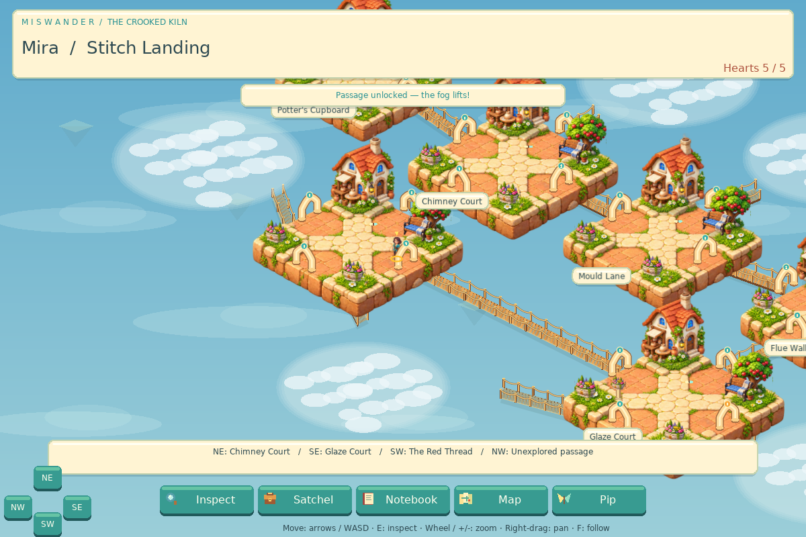

# Miswander

A Lua / LÖVE 11.5 exploration-and-puzzle prototype. Follow a loved one into a refuge assembled from stolen pieces of people's homes. A helpful Warden, a paper moth named Pip, and familiar objects lead you toward the truth—and a way home.

This update applies to the **2D LÖVE game**. The separate `godot/` prototype and existing Windows ZIPs are unchanged and still contain their earlier ISOMET builds.



## Launch

From this project folder:

```sh
love .
```

The Miswander artwork appears for three seconds before world and character setup. Choose a traveler and name, then City, Suburb, or Midwest. The origin-specific pixel introduction leads into the refuge. Subsequent launches offer **Continue journey** or **New journey**.

The rooms, buildings, greenery, guardians and eight travelers now use high-resolution illustrated cartoon artwork with soft shading, rounded forms and saturated colors. Textured plank bridges have rope rails and posts. The splash uses the same artwork; parchment menus and puzzle controls retain their bright theme. The earlier PDF title extraction remains archived in `assets/` and is no longer used by the game. No additional game libraries are required. Generation provenance and prompts are in [assets/cartoon/README.md](assets/cartoon/README.md).

## Explore the tabletop maze

The camera starts zoomed out over a **connected isometric tabletop**, rather than showing one room at a time. Discovered rooms remain visible together, joined by bridges. Unexplored destinations are concealed by mist. Winning a new passage challenge reveals its room, dissolves the fog and walks the character across the bridge as the camera scrolls. Discovery is saved with your journey.

- **Mouse wheel / + / −:** zoom in or out.
- **Right-button drag:** pan the tabletop.
- **F:** return the view to following the character.
- **Two-finger drag / pinch:** pan / zoom on touch devices (physical-device testing remains outstanding).

Each environment has its own connected tabletop; story exits still lead to the next environment. Revealed rooms keep their names, while fog never shows hidden scenery, rewards or room names. New room tasks are now opened with **E / Inspect** after the crossing, so the reveal can play without a dialogue covering it.

## Unseal passages

Walk into an arch to try its passage. **The first crossing requires five match-three lines in eighteen neighboring swaps.** Tap two adjacent pieces, or use arrows and Space/Enter to select them. Match three or more horizontally or vertically. Cascades count, and dead boards reshuffle for free. A neighboring swap uses one attempt even if it makes no line; the pieces then return to their original positions. Selecting a distant piece simply changes selection.

A successful passage unlock is permanent in both directions. Backtracking never requires replaying its board. Marked task rooms have their own inspect action: discover tools, use them at mechanisms, read companion traces, or face a warned timing challenge. Some mechanisms have an additional match-three task. Missing items cost nothing, and retreat is free.

Arches show their destinations or marking names at the bottom of the screen; gold floor markers indicate item-gated routes. Use **Inspect** inside a room, and **Pip** for the next required clue. The map contains only visited locations and inspected passage information.

## Controls

| Action | Keyboard | Mouse / touch |
| --- | --- | --- |
| Move NE / SE / SW / NW | Up / Right / Down / Left, or W / D / S / A | Hold a direction on the bottom-left pad |
| Run | Shift | — |
| Inspect current room | E | Inspect button |
| Satchel / notebook / map / Pip hint | I / J / M / P | Bottom toolbar |
| Toggle/use lantern | L | Satchel → Supplies |
| Zoom / pan / follow | Wheel or +/−; right-drag; F | Two-finger drag / pinch |
| Pause | Escape | — |
| Reload saved journey | F5 | — |
| Start new traveler (asks first) | Ctrl+N | New journey at launch |
| Open saved files | O | — |
| Match-three selection | Arrows + Space/Enter | Tap two neighboring pieces |
| Hazard/guardian crossing or strike | Space/Enter | Cross / strike button |
| Slower timing assist | P during a timing task | Pip assist button |
| Read long panels | Wheel or Page Up/Down | Wheel; swipe scrolling supported on panels |
| Select a panel action | Up/Down + Enter | Tap the action |
| Retreat from an unfinished challenge | Escape | Return safely / retreat button |

Touch buttons and the movement pad are a desktop-tested preparation for mobile. Physical Android/iOS testing, platform packaging, native lifecycle behavior, portrait layouts and full mobile accessibility remain future work.

## The campaign

The authored campaign follows the master plan's four environments and 32 named doors, with a branching corridor ring in each environment, deterministic quest rewards, optional side rooms and shortcuts, and an origin-specific rescue ending. Room dimensions and sparse pillars are generated once; the dependency graph is authored to stay solvable. There are seven corridor spaces and eight interiors per environment (60 rooms in the room files). The game does not display the total environment count.

The satchel has Quest, Supplies, Materials, Memories and Wardrobe compartments. Quest storage is unlimited. Tools and keys are retained; installed tools remain recorded. The notebook preserves evidence, warnings, companion traces and transition transcripts. Early inspections never grant a later clue prematurely.

Hazards and guardians currently use **three safe-window timing actions**, with explicit safe/warning/danger feedback and a slower assist. They are functional stand-ins for the plan's distinct vent lanes, water routes, sliding rooms and guardian encounters. The rescue finale uses four saved interactions and an origin-specific written reunion; it is not yet a fully animated finale.

## Hearts, light and optional crafting

You have five hearts. A failed scored board or fatal timing action loses exactly one heart and returns you to the current environment's entrance. Quest rewards, solved tasks, discoveries and unlocked passages remain. At zero hearts, progress is saved and dangerous rooms/challenges wait; notebook and inventory stay available. A free heart returns every twenty minutes, including time away from the app. There are no payments or refill purchases in this build.

Power Cells provide five minutes of optional bright lantern light. The timer pauses while reading, choosing menus, solving puzzles or watching scenes. Optional side rooms stay dimly navigable without a cell. One cell is supplied initially; free recharge grants another every twenty minutes. Practice at a completed matching mechanism alternates Glow Shards and Copper Scrap. Optional room completion grants Thread once.

- Craft one Power Cell: **2 Glow Shards + 1 Copper Scrap**.
- Expand optional-material storage by ten: **3 Copper Scrap + 2 Thread**.
- Initial material capacity: **30**. Overflow is retained in an unlimited claim tray and can be used directly in recipes.

Crafting, storage, lantern cells and practice are optional. The rescue never requires a purchase or crafted item. Cosmetic purchases, word-game mode, paid packs and store integrations from the plan remain proposals.

## Saves and editable rooms

Press **O** to open LÖVE's existing `isomet-void` save directory. Keeping the identity preserves the earlier prototype's data. Typical Linux path: `~/.local/share/love/isomet-void/`.

- `miswander-world.txt`: campaign room count, currently 60.
- `miswander-rooms/1.room` through `60.room`: editable geometry and reciprocal exits.
- `miswander-journey.txt`: versioned plain-text profile, checkpoint, hearts, quest flags, journal, passage unlocks and optional supplies.
- `.tmp` / `.bak`: temporary write and recovery files, when needed.

Earlier `world.txt` and `rooms/` files are preserved; they are not migrated into the authored campaign. Continue restores the Miswander checkpoint. Saving occurs after meaningful changes, every ten seconds of exploration, on pause and on normal quit. An unfinished board resets after closing; it does not consume a heart merely for closing. New journey replaces progress only after the new introduction finishes.

Room geometry uses the existing format:

```text
name = Chimney Court
size = 9 8
portal = false
exit = NE 8
exit = SE 2
pillar = 2.5 2.5
```

Dimensions must be 5–16; pillars must be inside the floor and should leave paths clear. Connections must be reciprocal on opposite sides. `campaign.lua` assigns stable IDs, canonical names, four local corridor graphs and task metadata. Change lore, rewards, dependencies and campaign topology there. Edited room files must retain local connectivity and the final room's portal. Back up both room files and journey data before editing. Do not renumber rooms during a saved journey.

## Source and design

See [MISWANDER_IMPLEMENTATION.md](MISWANDER_IMPLEMENTATION.md) for plan coverage, source responsibilities, deliberate prototype substitutions and remaining work. See [ART_DIRECTION.md](ART_DIRECTION.md) for the new visual system, scrolling tabletop, fog rules and save compatibility. [DESIGN.md](DESIGN.md) preserves the earlier source guide and links to the current campaign architecture. [docs/LEGACY_README.md](docs/LEGACY_README.md) archives the preceding prototype instructions.

## Verification

```sh
lua tests/world_test.lua
lua tests/characters_test.lua
lua tests/intro_test.lua
lua tests/miswander_test.lua
lua tests/savefile_test.lua
luajit tests/miswander_test.lua
lua tests/tabletop_test.lua
python3 tests/assets_test.py
python3 tests/run_love_tests.py
```

The optional atlas check uses Pillow (`python3 -m pip install Pillow` if absent); no Python package is needed to play the game.

The campaign tests cover 200 seeded layouts and boards, dependency ordering, serialization, unique rewards, lives, both finale prerequisites, free recharge, crafting and overflow. The isolated LÖVE test uses real callbacks and puzzle rules to exercise setup, passage unlocking, all 32 tasks, rescue, failure retention, resume and minimum-size rendering. It saves preview screenshots under the temporary directory printed at completion and leaves normal player saves untouched.

For a brief startup-only check: `XDG_DATA_HOME=/tmp/miswander-smoke ISOMET_SMOKE=1 love .`.
