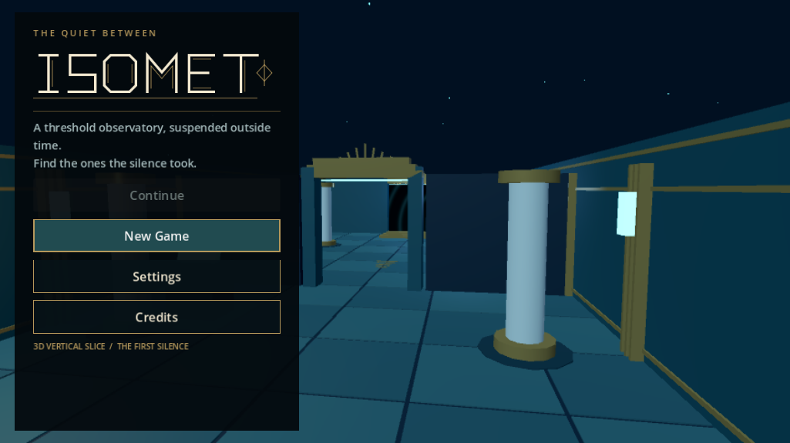
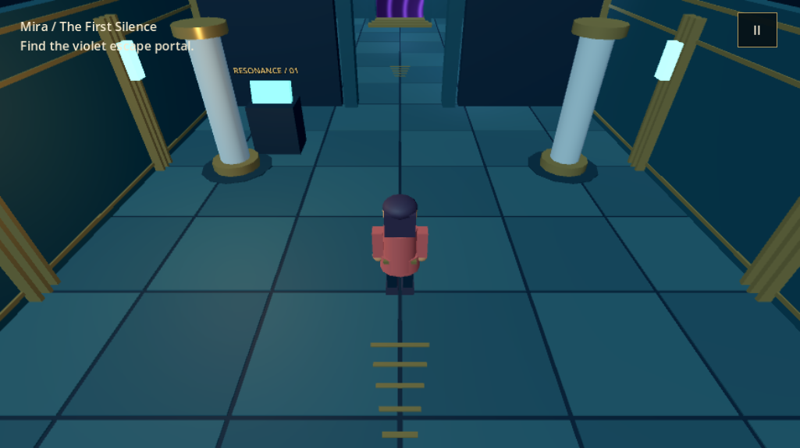

# Verification record — 17 October 2026

## What was actually run

Godot **4.5.2.stable.official.6ce3de25a**, standard Linux x86-64 build, was downloaded to `/tmp/isomet-godot/` and used to import, parse and execute the project. No engine is bundled in source control.

| Check | Result |
| --- | --- |
| Godot editor import and GDScript parse | Passed |
| Headless engine integration suite | Passed |
| Rendered smoke flow | Passed |
| Original Lua world, character and introduction suites | Passed unchanged |
| Actual capsule movement through the connecting arch | Passed |
| Physical floor and pillar collision | Passed |
| All eight variants and opposite-gender companion selection | Passed |
| Three 3D introduction settings and reaction state | Passed |
| Console, narrative note, portal and victory | Passed |
| JSON checkpoint round trip and Continue | Passed |
| Invalid checkpoint coordinates / variant / empty data | Rejected |
| Settings write/read | Passed |
| Existing-save overwrite confirmation | Passed |
| Synthetic simultaneous left-stick and right-look touch events | Passed; not a physical touch test |
| Generated audio shutdown in fixed-FPS tests | Passed after allowing mixer cleanup |

The fixed-FPS test harness runs real Godot physics, rather than mocking movement or collision. Its special save paths keep tests separate from normal progress. The initial pre-isolation implementation checkpoint was archived rather than left as the player's Continue slot.

Screenshots were inspected for title, creation, gameplay, settings, compact virtual layout, mobile-style menu layout and all three introduction settings. A camera handoff issue identified in the screenshots was corrected: the camera now snaps to a valid starting position, raycasts through intermediate geometry, and stays inside the perimeter. Mobile-style captures only exercise the UI branch on Linux; they do not prove safe-area behavior or usability on a phone.

## Local GPU performance evidence

Host: **AMD Ryzen 7 5825U**, integrated **AMD Radeon Graphics**, Gentoo Linux, Mesa 26.1.8 / radeonsi, DRM 3.64, kernel 6.18.54. Godot Compatibility renderer. Balanced quality, 85% requested 3D scale, 2× MSAA, 60 FPS cap.

The built-in benchmark repeatedly walks between the first chamber, console area, connecting arch and portal chamber. It samples wall-clock frame intervals after a two-second warm-up for approximately thirty seconds. It does not run other renderer/gallery instances concurrently.

Initial windowed measurement:

| Metric | Value |
| --- | --- |
| Logical UI viewport | 1280 × 720 |
| Actual output texture under the desktop compositor | 821 × 461 |
| Sampled frames | 1,801 |
| Mean frame interval | 16.6665 ms (~60 FPS) |
| 95th percentile | 17.037 ms |
| Visible draw calls at final sample | 42 |
| Visible triangles at final sample | 6,522 |

**This is not a native-720p performance claim**: the compositor-sized output was smaller than the logical viewport. The p95 also slightly exceeds the strict 16.7 ms desktop acceptance target. A fullscreen follow-up is recorded in [local-benchmark.json](local-benchmark.json). Draw calls and triangle counts are a snapshot, not a route-wide maximum. The run is too short to establish thermal stability.

Fullscreen follow-up, same hardware and Balanced preset:

| Metric | Value |
| --- | --- |
| Logical UI viewport | 1280 × 720 |
| Actual fullscreen output texture | 2880 × 1620 |
| Sampled frames | 1,801 |
| Mean frame interval | 16.6666 ms (~60 FPS) |
| 95th percentile | 16.908 ms |
| Visible draw calls / triangles at final sample | 42 / 6,522 |

This is the stronger local GPU baseline. The configured 85% 3D scale is a requested quality setting; the report records the final output texture, not a separately measured internal scene target. The p95 remains slightly above 16.7 ms, and a short Linux test does not establish a sustained Windows or phone guarantee.

The benchmark's `--fixed-fps` option is intentionally not used for performance measurement; fixed-FPS is only for deterministic functional tests. Headless test speed is not GPU performance.

## Not validated

- Physical Android or iOS devices, actual multi-touch, notch/gesture safe areas, native soft keyboards, battery use, thermal throttling or app-store lifecycle behavior.
- Windows native execution, driver behavior, signing, scaling or quit-to-desktop on an actual Windows installation. Export itself has now succeeded; see below.
- Android APK/AAB or iOS Xcode/IPA builds; required SDK/templates/signing hardware are not installed/configured here.
- Sustained native 30 FPS phone or 60 FPS Windows guarantees, memory budgets or a certified minimum device list.
- Full 3D procedural maze conversion, saved-room migration, final production art or final cinematic quality.

See [PLATFORMS.md](PLATFORMS.md) for proposed device floors, build prerequisites and the physical-device acceptance procedure. These remain open validation requirements rather than inferred successes from the Linux test.

## Local previews

These screenshots show the procedural art blockout, not final production assets.

## Windows release package

A Windows x86-64 **release** build was exported using the official Godot 4.5.2 `windows_release_x86_64.exe` template. The embedded-PCK option puts the project assets inside `ISOMET.exe`; the shareable ZIP includes instructions, the Godot MIT license, upstream third-party notices and an EXE SHA-256 digest.

- Export command completed successfully.
- Binary inspection confirmed a Windows GUI PE32+ x86-64 executable.
- The matching Linux engine loaded the PCK embedded in the Windows EXE; smoke checks passed.
- The exported PCK also completed rendered gallery checks, including the title artwork and spatial portal shader.
- ZIP CRC integrity and the embedded EXE SHA-256 were verified.
- No Wine or physical Windows system is available here, so the actual Windows executable has **not** been run natively. This package is for the requested tester trial, not a Windows compatibility certification.

The build artifacts are under `godot/builds/windows/`, ignored by Git. No user checkpoint or local settings file is included.
